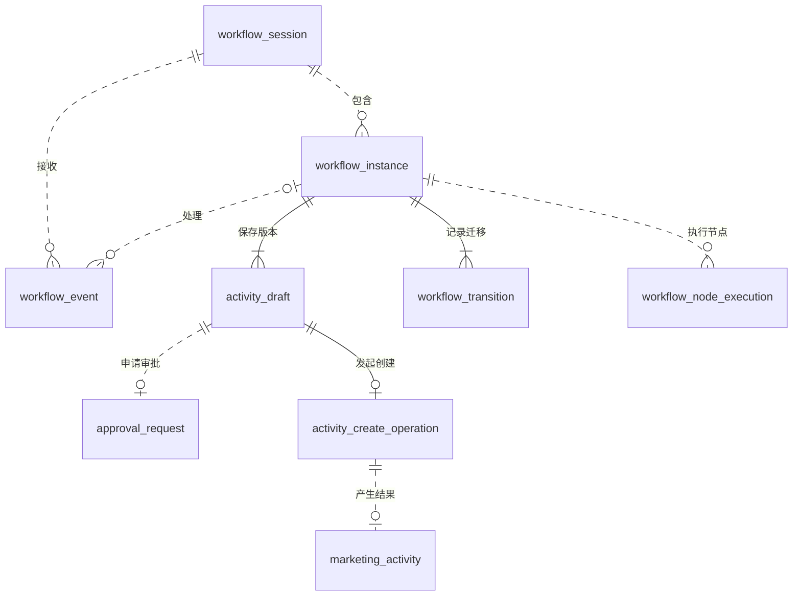

# 智能营销活动 Agent Workflow PostgreSQL 数据库设计

本设计覆盖多轮会话、活动草稿、用户确认、模拟审批、幂等创建、结果对账和状态审计。Go 服务通过 PostgreSQL 持久化工作流，重启后可以恢复等待中的事件与任务。原始需求见[项目设计](智能营销活动_Agent_Workflow_项目设计.md)，物理结构见[初始化 SQL](../db/migrations/000001_init.sql)。

## 数据建模约定

- 业务表统一放在 `agent_workflow` schema 下。建表只声明 PostgreSQL 数据类型，不声明外键、主键、唯一约束、非空约束、检查约束、默认值或自增列。索引用于普通查询和调度扫描，均为非唯一索引。
- 表中的业务标识、归属关系、必填字段、状态值及金额范围由 Go 写入层校验。内部 ID 由应用生成 UUID，账号、用户、模板、活动和上游快照等业务标识使用 `text`。每次写入由应用显式提供业务状态、初始版本、计数和时间。
- 时间点使用 `timestamptz`，发送时间同时保存 IANA 时区，国内演示使用 `Asia/Shanghai`。相对时间解析使用事件的 `reference_at`，提交时按实际当前时间检查发送窗口。金额使用 `bigint` 保存货币最小单位，`CNY` 以分计。未知金额和人数以 SQL `NULL` 表示。
- 草稿中参与检索或常用业务判断的字段使用独立列。人群规则、查询证据、校验详情和扩展参数使用 `jsonb`，结构由 Go 定义并校验。可选字段尚未产生时保存 SQL `NULL`。

## 表与逻辑关系

下表中的标识由应用维护，关系用于归属校验和业务查询。

| 表 | 逻辑标识 | 用途 |
|---|---|---|
| `workflow_session` | `session_id` | 会话归属和默认工作流上下文 |
| `workflow_instance` | `workflow_id` | 当前节点、状态、修订号和关联结果 |
| `activity_draft` | `workflow_id, draft_version` | 草稿版本、查询证据、预览与用户确认 |
| `workflow_event` | `event_id`，去重使用 `source, source_event_id` | 入站事件、对话记录、处理结果与恢复 |
| `workflow_transition` | `workflow_id, state_revision` | 状态变更审计 |
| `approval_request` | `approval_id` | 模拟审批及版本、预览和确认绑定 |
| `activity_create_operation` | `idempotency_key`，每个 `workflow_id, draft_version` 至多一个操作 | 创建请求、重试及结果对账 |
| `marketing_activity` | `activity_id`，按 `idempotency_key` 回查 | 模拟活动服务创建的业务结果 |
| `workflow_node_execution` | `execution_id` | 节点、模型及工具尝试记录 |



通用问答或尚未路由的会话消息可以只有 `session_id`。一个会话支持多次创建任务，审批、确认和核查事件应定位到具体工作流。

## 字段字典

### workflow_session

| 字段 | 类型 | 含义 |
|---|---|---|
| `session_id` | uuid | 一次多轮会话的内部标识 |
| `user_id`、`account_id` | text | 会话用户及营销账户，来自已验证身份 |
| `active_workflow_id` | uuid | 最近绑定的工作流，可空。明确指定目标时以归属校验后的目标为准 |
| `created_at`、`updated_at` | timestamptz | 创建及更新时刻 |

### workflow_instance

| 字段 | 类型 | 含义 |
|---|---|---|
| `workflow_id`、`session_id` | uuid | 工作流实例及所属会话 |
| `status`、`current_node`、`intent_name` | text | 业务状态、恢复节点及最近的已识别意图 |
| `workflow_version` | text | 工作流定义版本，例如 `1.0.0` |
| `state_revision` | bigint | 持久化修订号，从 1 开始，每次业务状态或上下文更新递增 |
| `draft_version` | bigint | 当前草稿版本，从 1 开始 |
| `approval_id` | uuid | 当前有效审批指针，尚未申请或审批失效时为空 |
| `activity_id` | text | 已核实的活动 ID，完成前为空 |
| `last_error_code`、`last_error_detail` | text、jsonb | 最近一次影响流程的错误及脱敏详情 |
| `created_at`、`updated_at` | timestamptz | 创建及最近更新时刻 |

### activity_draft

| 字段 | 类型 | 含义 |
|---|---|---|
| `workflow_id`、`draft_version` | uuid、bigint | 草稿所属工作流及版本 |
| `activity_name`、`audience_rule` | text、jsonb | 活动名称和结构化人群筛选条件 |
| `scheduled_at`、`timezone`、`template_id` | timestamptz、text、text | 计划发送时刻、业务时区和模板标识 |
| `extra_slots`、`missing_slots` | jsonb | 扩展参数对象和待补字段名称数组 |
| `audience_snapshot_id`、`audience_count` | text、bigint | 真实工具返回的人群快照 ID 和人数 |
| `template_status` | text | 工具查询时的模板审核状态 |
| `estimated_cost_minor`、`currency` | bigint、text | 费用估算和币种 |
| `snapshot_json` | jsonb | 人群、模板、额度及政策来源证据。时效性分支保存查询时间和有效期 |
| `rule_version`、`validation_json` | text、jsonb | 生效规则版本和 Schema、业务校验结果 |
| `preview_id`、`previewed_at`、`preview_expires_at` | uuid、timestamptz、timestamptz | 发布的预览标识、发布时间和有效期 |
| `confirmation_version`、`confirmation_event_id`、`confirmed_by` | bigint、uuid、text | 确认的草稿版本、确认事件和用户 |
| `confirmed_at`、`confirmation_expires_at` | timestamptz | 用户确认时间及有效期 |
| `created_at`、`updated_at` | timestamptz | 该版本创建及更新时刻 |

### workflow_event

| 字段 | 类型 | 含义 |
|---|---|---|
| `event_id`、`session_id`、`workflow_id` | uuid | 内部事件、所属会话与业务目标。尚未路由时工作流可空 |
| `source`、`source_event_id` | text | 经认证的来源命名空间及上游稳定事件 ID，用于重复投递判定 |
| `event_type`、`actor_type`、`actor_id` | text | 事件类型、操作者类型及标识 |
| `request_hash`、`payload`、`result_json` | text、jsonb、jsonb | 规范化入站请求摘要、脱敏载荷和处理检查点或最终结果 |
| `status`、`attempt_count` | text、integer | 处理状态和处理尝试次数 |
| `next_attempt_at`、`lease_expires_at` | timestamptz | 下次可处理时间和当前租约到期时间 |
| `lease_token`、`last_error_code` | uuid、text | 本次认领令牌和最近错误码 |
| `reference_at` | timestamptz | 事件业务基准时刻，供相对时间解析和回放 |
| `created_at`、`updated_at`、`processed_at` | timestamptz | 收到、更新和处理结束的时刻 |

事件类型沿用项目设计中的 `USER_MESSAGE`、`USER_CONFIRM`、`USER_CANCEL`、`APPROVAL_APPROVED`、`APPROVAL_REJECTED`、`APPROVAL_WITHDRAWN`、`CREATE_RESULT`、`RECONCILE_RESULT`、`SCHEDULED_RETRY`。处理状态为 `RECEIVED`、`PROCESSING`、`RETRY_WAIT`、`APPLIED`、`IGNORED`、`FAILED`。

### workflow_transition

| 字段 | 类型 | 含义 |
|---|---|---|
| `workflow_id`、`state_revision` | uuid、bigint | 工作流和迁移提交后的修订号 |
| `event_id`、`draft_version` | uuid、bigint | 触发事件及当时的草稿版本 |
| `from_status`、`to_status` | text | 迁移前后状态，初始化时 `from_status` 为空 |
| `reason_code`、`reason_detail` | text、jsonb | 原因代码和脱敏说明 |
| `actor_type`、`actor_id`、`created_at` | text、text、timestamptz | 操作者及迁移发生时间 |

### approval_request

| 字段 | 类型 | 含义 |
|---|---|---|
| `approval_id`、`workflow_id`、`draft_version` | uuid、uuid、bigint | 审批单标识及对应的工作流和草稿版本 |
| `preview_id`、`confirmation_event_id` | uuid | 发起审批所依据的预览及用户确认事件 |
| `status` | text | `PENDING`、`APPROVED`、`REJECTED`、`WITHDRAWN` 或 `INVALIDATED` |
| `request_event_id`、`request_json` | uuid、jsonb | 触发事件及审批提交快照，包含审批阈值和触发依据 |
| `decision_event_id`、`decided_by`、`decided_at` | uuid、text、timestamptz | 生效的审批或撤回事件、处理人和时间 |
| `reason`、`invalidated_at` | text、timestamptz | 决定或失效原因及失效时刻 |
| `created_at`、`updated_at` | timestamptz | 审批发起及最近更新时间 |

### activity_create_operation

| 字段 | 类型 | 含义 |
|---|---|---|
| `idempotency_key`、`workflow_id`、`draft_version` | text、uuid、bigint | 稳定幂等键及其业务目标 |
| `confirmation_event_id`、`authorization_event_id` | uuid | 用户确认事件及允许创建的事件，需审批时后者为审批通过事件 |
| `request_hash`、`request_json` | text、jsonb | 首次授权时冻结的规范化请求摘要与实际命令 |
| `status`、`activity_id` | text | 操作状态及已核实的活动 ID |
| `attempt_count`、`reconcile_count` | integer | 创建及核查尝试计数，分别计数 |
| `next_attempt_at`、`lease_expires_at` | timestamptz | 下次调度时间及当前租约到期时间 |
| `lease_token` | uuid | 当前创建或核查任务的认领令牌 |
| `last_error_code`、`last_error_detail` | text、jsonb | 最近错误及脱敏诊断信息 |
| `created_at`、`updated_at`、`finished_at` | timestamptz | 准备、更新及确认为成功或失败的时刻 |

操作状态使用 `READY`、`IN_FLIGHT`、`RETRY_WAIT`、`PENDING_RECONCILIATION`、`RECONCILING`、`SUCCEEDED`、`FAILED`。其中 `RETRY_WAIT` 表示已确认可再次发送创建请求，`PENDING_RECONCILIATION` 表示下一步先核查。

### marketing_activity

| 字段 | 类型 | 含义 |
|---|---|---|
| `activity_id`、`idempotency_key`、`request_hash` | text | 活动业务 ID、创建幂等键和请求摘要 |
| `workflow_id`、`draft_version` | uuid、bigint | 创建来源及草稿版本 |
| `account_id`、`created_by`、`activity_name` | text | 营销账户、发起人和活动名称 |
| `audience_rule`、`audience_snapshot_id`、`audience_count` | jsonb、text、bigint | 创建时的人群规则、快照和人数 |
| `template_id`、`scheduled_at`、`timezone` | text、timestamptz、text | 模板、发送时刻和业务时区 |
| `estimated_cost_minor`、`currency` | bigint、text | 创建时的费用预估和币种 |
| `status`、`created_at`、`updated_at` | text、timestamptz、timestamptz | 活动状态和时间。模拟创建写入 `SCHEDULED` |

### workflow_node_execution

| 字段 | 类型 | 含义 |
|---|---|---|
| `execution_id`、`workflow_id`、`event_id`、`draft_version` | uuid、uuid、uuid、bigint | 一次尝试及对应工作流、触发事件和草稿版本 |
| `node_name`、`attempt_no` | text、integer | 节点名称及本轮节点尝试序号 |
| `tool_name`、`model_name`、`prompt_name`、`prompt_version` | text | 工具、模型和 Prompt 元数据，按节点类型写入 |
| `trace_id` | text | 后续观测平台关联标识，可空 |
| `status`、`input_json`、`output_json`、`error_code` | text、jsonb、jsonb、text | 尝试状态、脱敏输入和结果、错误类型 |
| `started_at`、`finished_at` | timestamptz | 节点开始与结束时间 |

## 事务与并发

同一逻辑键的读后写操作统一通过 Go 仓储执行。使用 `READ COMMITTED` 事务，在独立 SQL 语句中先取事务级 advisory lock，随后按业务标识读最新行、校验并写入。同一身份空间的键统一编码并映射为稳定的 32 位哈希，锁使用独立的整数空间编号和哈希值，例如 `SELECT pg_advisory_xact_lock($1::integer, $2::integer)`。哈希碰撞会让无关操作临时串行，读取时仍匹配完整业务标识。[PostgreSQL 事务隔离](https://www.postgresql.org/docs/current/transaction-iso.html) · [PostgreSQL Advisory Locks](https://www.postgresql.org/docs/current/explicit-locking.html#ADVISORY-LOCKS)

多个锁按会话、事件、工作流、创建操作、模拟活动的顺序获取，同一空间内按锁键数值排序。草稿、审批和迁移审计由工作流锁保护。事件入库、调度和写回使用同一事件锁，完整键为 `(source, source_event_id)`。创建操作和模拟活动各自按幂等键上锁。读到多条预期唯一的业务记录时按数据完整性故障中止；更新影响行数与预期不符时回滚。

工作流每次落盘使用 `state_revision` 和预期状态做 CAS。关联写入与工作流更新放入同一事务，包括当前草稿指针、审批记录、创建操作、适用的状态审计和该次事件处理结果。仅业务状态变化时追加迁移记录，审计修订号可以有间隔。模型和工具调用放在事务外，提交结果时重新校验当前版本、状态及有效租约。

```sql
UPDATE agent_workflow.workflow_instance
SET status = $1,
    current_node = $2,
    state_revision = state_revision + 1,
    updated_at = $3
WHERE workflow_id = $4
  AND state_revision = $5
  AND status = $6;
```

应用检查上例恰好更新一行。遇到旧修订时重新读取上下文，根据事件目标判断重新执行或回绝，避免覆盖其他用户操作。

## 事件接收与恢复

1. 入口认证用户或回调来源，并校验账户、会话及工作流归属。来源命名空间应包含对应的信任域和事件 ID 适用范围，客户端对同一次投递复用事件 ID。锁定 `(source, source_event_id)` 后查询。首次送达写入 `RECEIVED`，重复且摘要相同则复用记录和已保存的处理结果，摘要不同则返回冲突。
2. Worker 扫描已到期的 `RECEIVED`、`RETRY_WAIT` 以及租约过期的 `PROCESSING`。候选扫描结束后逐条加锁，从事务内重新读取并校验状态；认领时写入新令牌、到期时间和尝试次数，提交后再执行。
3. 每次推进持久化检查点或写回结果时，在锁内确认租约令牌和到期时间仍有效。若同一事件跨多个事务，在 `result_json` 中随工作流提交检查点，记录已完成的步骤及提交后的修订号。恢复时结合检查点和最新状态继续，避免重复合并同一个草稿变更。事件处理结束后保存 `APPLIED` 或 `IGNORED` 及结果。暂时失败写入 `RETRY_WAIT` 和退避时间，已明确终止的事件标记为 `FAILED`。
4. 会话读取按 `session_id, created_at, event_id` 排序。确认类事件必须绑定 `workflow_id`、`draft_version` 和 `preview_id`。用户只说“确认”时，从服务端记录的回复上下文解析目标，目标不明确时返回当前预览供确认。

## 草稿、确认与审批

1. 新建工作流时在同一事务保存初始草稿和 `RUNNING` 审计。影响活动的参数变更创建下一版草稿，只继承仍有效的查询证据。人群变更后重查人数及费用，模板变更后重查审核状态及费用，发送时间变更后重验规则与时间窗口。
2. 必要查询和业务校验通过后发布预览，保存预览 ID、查询证据和有效期，进入 `WAITING_CONFIRMATION`。同一版本只发布一个预览。发布后冻结该版本的创建参数与预览证据；证据失效需要重新发布时，使用新版本。旧版本的确认保留为历史记录，新版本从未确认状态开始。
3. 确认事务同时校验当前状态、草稿版本、预览 ID、有效期和用户归属。重验权限、发送时间、模板、人群和额度后，按版本化规则选择直接授权创建或创建 `PENDING` 审批单。审批申请及 `WAITING_APPROVAL` 一起提交。
4. 审批回调须匹配当前审批、草稿版本、预览及确认事件。通过后再复验时间、额度、审批有效性和关键证据，只有仍满足条件才授权创建。审批等待时修改草稿使原审批失效，晚到回调记录为 `IGNORED`。需要补参时进入 `WAITING_INPUT`，能够重建有效预览时重新进入 `WAITING_CONFIRMATION`。
5. 工作流在 `RUNNING`、`WAITING_INPUT`、`WAITING_CONFIRMATION` 可按权限取消。`WAITING_APPROVAL` 须先确认审批撤回，再写入 `CANCELLED`。`CREATING` 或待核查时先确认创建结果；已创建活动走独立的活动取消流程。

## 创建幂等和结果对账

1. 授权事务内，由应用使用固定格式 `activity-create:v1:<workflow_id>:<draft_version>` 生成幂等键，保存规范化请求、摘要和 `READY` 操作，同时把工作流置为 `CREATING`。重复授权读取已有操作，并校验请求摘要。操作状态进入创建后，拒绝通过修改草稿生成新的创建请求。
2. 创建 Worker 在事务内认领操作，写入 `IN_FLIGHT`、新租约和尝试次数。事务提交后先按幂等键查询结果，再按重验后的业务条件和操作状态决定是否调用创建。所有调用和重试均使用同一幂等键及原始请求。
3. 模拟活动服务在独立事务中按创建操作、模拟活动的顺序取得锁。已存在且摘要相同则返回原活动；无结果时只允许持有效创建租约的请求插入活动。该流程覆盖活动记录已提交、调用返回前连接中断的场景。将来对接真实活动服务时，该服务需要提供并发幂等及按键核查，才能继续保障跨服务的重复创建控制。
4. Worker 按幂等键、事件类型和本次租约令牌构造内部结果事件的稳定来源 ID。在同一事务中记录结果事件，检查租约和修订号，并更新创建操作、工作流及审计。明确成功或核查确认已创建时保存活动 ID、`SUCCEEDED` 和工作流 `COMPLETED`，待提交后返回结果。明确可重试且当前没有未决结果时进入 `RETRY_WAIT`，使用同一幂等键限次重试。
5. 创建超时、响应不明或 `IN_FLIGHT` 租约到期时先进入 `PENDING_RECONCILIATION`。核查任务认领后进入 `RECONCILING`，租约到期时重新安排核查。已确认无未决写入、未创建且仍满足业务条件的情况下可以安排同键重试。可确认未创建且已终止时，只在已关闭该操作的创建通道后记录 `FAILED`。若结果仍不明则继续核查或转人工。核查期间工作流保持待核查，直至得到确定结论。

## 索引与数据留存

| 访问路径 | 索引列 |
|---|---|
| 会话、工作流、事件、审批及活动的直接查询 | 对应 ID |
| 会话近期工作流，按会话或工作流回溯消息 | 工作流 `(session_id, updated_at)`，事件 `(session_id, created_at, event_id)`、`(workflow_id, created_at, event_id)` |
| 草稿、审批和创建操作按版本查询 | 各表 `(workflow_id, draft_version)` |
| 事件去重和活动幂等核查 | 事件 `(source, source_event_id)`，创建操作及活动 `(idempotency_key)` |
| 待执行任务和租约过期扫描 | 事件及创建操作 `(status, next_attempt_at)`、`(status, lease_expires_at)` |
| 审批待办、迁移审计与节点回溯 | 审批 `(status, created_at)`，审计 `(workflow_id, state_revision)`，节点执行 ID 及 `(workflow_id, started_at, execution_id)` |

载荷和节点日志只保存恢复、审计及评测所需的脱敏数据。手机号、收件人名单、凭据和原始敏感属性应在写入前剔除。事件去重记录和创建幂等记录的保留期须覆盖允许的重放窗口及未完成对账，清理时保留仍被活跃流程引用的草稿、审批和操作。

## 初始化与验收

在空 schema 的开发数据库执行初始化脚本。脚本内含事务，执行失败时由 PostgreSQL 回滚。

```sh
psql "$DATABASE_URL" -v ON_ERROR_STOP=1 -f db/migrations/000001_init.sql
```

| 验收场景 | 数据库侧预期 |
|---|---|
| 初始化 | 建成 9 张业务表，系统目录中无业务表约束和唯一索引 |
| 多轮补参及旧确认 | 当前草稿版本递增，旧确认事件可追溯且无法授权新版 |
| 同事件并发投递 | 只保存一次入站记录，重复请求复用结果，迁移只生效一次 |
| 两端并发修改 | 同一旧修订号只有一方更新成功，另一方读到冲突 |
| 审批拒绝或修改后回调 | 保存拒绝或失效记录，旧审批无法授权创建 |
| 创建成功但响应超时 | 用原幂等键查到同一活动，工作流最终完成 |
| 创建和核查结果不明 | 保持待核查，重启或租约到期后可恢复，活动记录不重复 |
