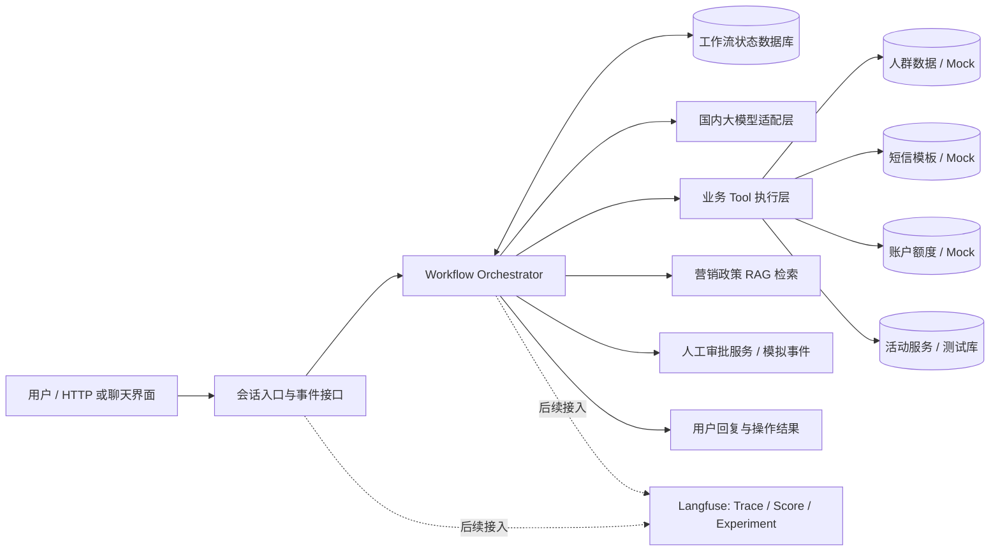
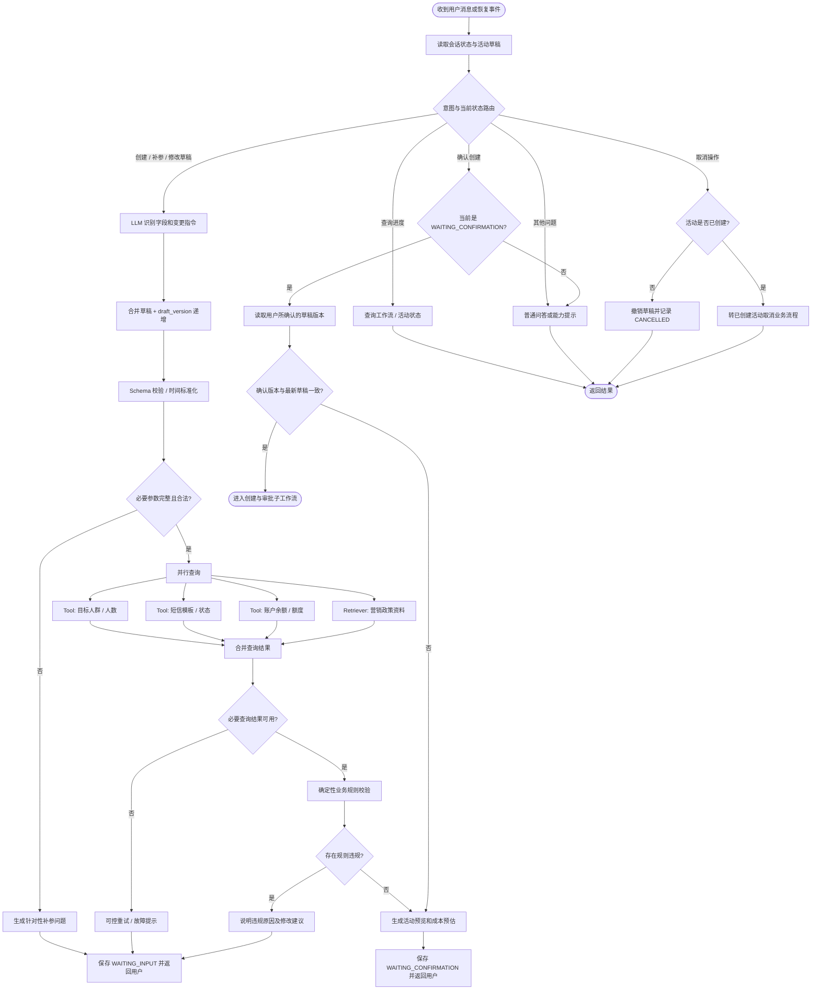
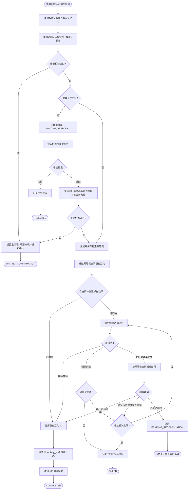
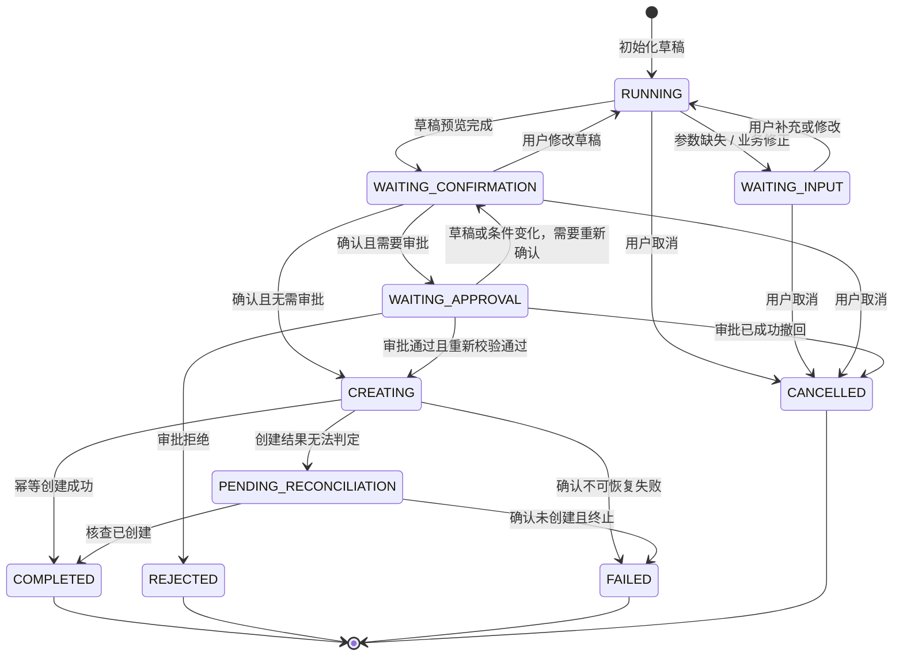
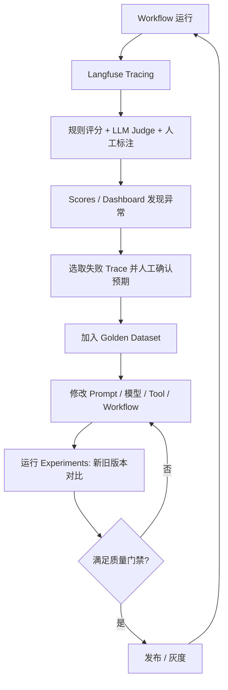

# 智能营销活动 Agent Workflow｜项目设计与开发指南

> **文档版本**：v1.0（开发设计稿）  
> **项目定位**：国内营销业务场景下，具备多轮交互、工具调用、状态持久化、人工审批和异常恢复能力的 Agent Workflow 练习项目  
> **建议技术路线**：Go + Go-Eino + 国内大模型（DeepSeek / 通义千问，可替换）  
> **后续目标**：接入 Langfuse，完整演练 Tracing、Scores、Evaluators、Human Annotation、Datasets 与 Experiments  
> **说明**：本文整合当前讨论已经确定的流程和状态机，并将若干开发必需的字段、契约及验收标准作为**建议设计**补充。它们不是已有代码的描述，具体业务阈值均为教学模拟配置。

---

## 1. 项目背景与目标

开发一个“智能营销活动创建与审核”Agent。用户通过自然语言描述营销需求，系统负责理解意图、收集和调整活动参数、查询真实业务数据、检查约束、要求确认、必要时发起人工审批，最终安全地创建活动。

该项目**不是**简单的“用户输入 → LLM → 工具 → 输出”，而是重点学习如下工程能力：

1. **多意图路由**：创建、补充参数、修改草稿、查询、确认、取消及普通问答。
2. **多轮补参和中断恢复**：每轮消息基于已持久化的会话/草稿状态继续，而非从头执行。
3. **LLM 与确定性业务规则分工**：模型负责理解语言；业务代码负责权限、时间、额度、幂等等硬约束。
4. **并行工具调用**：并发查询人群、短信模板、额度和知识库。
5. **人工确认和审批**：用户确认与公司内部审批是两种不同的流程控制。
6. **异常处理**：超时、重试、部分成功、未知结果和幂等创建。
7. **可评测性**：每个节点应有独立的输入、输出、状态和可测试断言，为以后接入 Langfuse 做准备。

### 1.1 项目范围

**纳入首期**：活动草稿、活动参数收集、预计人群查询、短信模板查询、营销规则查询、预算或额度检查、用户确认、人工审批、创建活动、状态/审计记录、故障恢复。

**首期不做**：真实向手机号批量发送短信、复杂营销分群编辑器、计费结算、线上审批 OA 集成。使用 Mock Tool、测试数据库与模拟审批事件即可；创建活动只代表产生待执行的业务记录，**不等于执行短信发送**。

### 1.2 推荐的演示用户需求

> “帮我创建一个营销活动，面向最近 30 天消费超过 500 元的用户，明天上午 10 点发送，优先选择通知类模板。”

系统可能需要追问模板、提供预计人数与费用、让用户修改发送时间，甚至因人数或预算条件触发人工审批。

---

## 2. 业务对象与参数

### 2.1 活动草稿（Activity Draft）

| 字段 | 示例 | 说明 |
|---|---|---|
| `activity_name` | 会员复购提醒 | 活动名称，可由用户输入或提出建议 |
| `audience_rule` | 最近30天消费金额大于500元 | 自然语言转结构化人群条件 |
| `audience_snapshot_id` | `aud-snap-001` | 人群查询快照或查询版本，防止前后不一致 |
| `audience_count` | 18,500 | 预计触达人数，工具结果，不允许 LLM 编造 |
| `template_id` | `tpl-001` | 短信模板 ID |
| `template_status` | `APPROVED` | 模板审核状态，工具结果 |
| `scheduled_at` | `2026-11-21T10:00:00+08:00` | 发送时间，按业务时区解析并存储 |
| `estimated_cost` | 以工具查询结果为准 | 预算预估，不允许编造价格 |
| `draft_version` | 3 | 草稿修改版本，保证确认的是最新草稿 |
| `confirmation_version` | 3 | 用户最终确认时绑定的草稿版本 |

> 时间示例仅用于教学。生产实现中必须保存时区，并在每次提交前按**实际当前时间**复验，不能依赖固定示例日期。

### 2.2 主要意图（推荐枚举）

| 意图 | 含义 | 进入的处理路径 |
|---|---|---|
| `create_activity` | 新建营销活动 | 参数提取/草稿更新 |
| `update_activity_draft` | 修改未提交的活动草稿 | 读取草稿后部分更新 |
| `provide_slots` | 回答系统追问，补充参数 | 根据当前状态合并槽位 |
| `confirm_activity` | 用户确认创建 | 检查草稿版本，进入审批/创建 |
| `cancel_workflow` | 取消尚未完成的工作流 | 状态校验与取消 |
| `query_activity` | 查询活动/工作流状态 | 查询工具 |
| `other` | 闲聊或不支持请求 | 问答/说明能力边界 |

**重要**：意图识别必须结合当前工作流状态。例如用户只说“确认”，在 `WAITING_CONFIRMATION` 状态下才可能代表批准当前草稿；在普通聊天中不得直接触发创建。

---

## 3. 系统架构总览



### 3.1 模块职责建议

- **会话入口**：接收用户输入、审批回调、取消事件及状态查询。
- **Workflow Orchestrator**：节点编排、分支路由、状态流转、并行协调及恢复。
- **LLM 适配层**：意图识别、槽位提取、补参问题生成、结果解释；应能切换 DeepSeek/Qwen。
- **Tool 层**：稳定的结构化 I/O、超时与错误分类；数据库写入和外部调用必须受业务校验约束。
- **Rule Engine**：确定性的校验、确认约束、审批门槛、权限、额度、幂等等。
- **State Repository**：原子读写和版本控制，防止会话丢失及并发覆盖。
- **Approval Service**：持久化审批单，接收“通过/拒绝/撤回”事件后恢复工作流。
- **Langfuse（后续）**：评测与观测平台，不参与业务正确性的最终裁决。

---

## 4. 主工作流流转图

覆盖意图路由、多轮补参、并行查询、规则检查、预览确认，以及查询/取消等非创建分支。



### 4.1 多轮对话的正确理解

图中 `WAITING_INPUT`、`WAITING_CONFIRMATION` 是**持久化等待状态**，不是通过一个死循环持续占用 goroutine/线程。用户下一轮消息到达时，重新进入入口 `A`，加载同一个 `session_id` / `workflow_id`，根据状态继续。

### 4.2 并行查询的边界

- 人群、模板、账户额度、RAG 可以并行，但**在合并节点必须检查必要分支是否成功**。
- RAG 只负责提供规则解释和出处；硬性限制必须落在版本化的业务规则配置或代码里。
- 任一关键查询失败，不得跳过校验直接创建活动；要允许明确的重试或等待恢复。
- 用户修改人群、时间或模板后，相关查询结果和先前确认可能失效，需要重新计算并重新确认。

---

## 5. 创建与审批子工作流流转图

本流程只有在用户确认了当前草稿后才进入；人工审批条件可根据模拟规则配置。注意审批时间可能很长，必须**持久化等待审批事件**。



### 5.1 子工作流的硬约束

1. **先确认再创建**：确认必须绑定 `draft_version`。用户确认后修改过草稿，原确认立即失效。
2. **审批不是用户确认**：用户确认创建意愿；审批员判断是否符合组织政策。两者都可能需要。
3. **审批通过后再复验**：额度、发送时间、模板状态可能在等待审批期间变化。
4. **幂等键稳定**：针对同一创建操作，重试必须复用同一幂等键；不能每次请求重新生成。
5. **超时 ≠ 失败**：调用超时可能已经成功写入业务数据库，先核查再决定是否重试。
6. **结果未知要可对账**：进入 `PENDING_RECONCILIATION`，定时核查或人工处理；严禁无条件重复创建。
7. **取消须校验状态**：审批撤回成功才能标记取消；已经创建的活动不能把草稿标记为取消就视为业务撤销。

---

## 6. Workflow 状态机设计

### 6.1 状态机图



> `PENDING_RECONCILIATION` 可长期处于等待中，不应通过超时直接认定失败。它必须由核查流程给出确定结论，或进入人工处理队列。已创建活动的撤销另建业务流程，不从 `COMPLETED` 直接回到 `CANCELLED`。

### 6.2 状态语义与外部事件

| 状态 | 含义 | 典型触发事件 | 是否等待外部输入 |
|---|---|---|---|
| `RUNNING` | 正在执行节点 | `USER_MESSAGE`、`RESUME` | 否 |
| `WAITING_INPUT` | 必填参数不全/不合法 | `USER_MESSAGE` | 是 |
| `WAITING_CONFIRMATION` | 等用户确认最新预览 | `CONFIRM`、`USER_MESSAGE`、`CANCEL` | 是 |
| `WAITING_APPROVAL` | 审批单待处理 | `APPROVE`、`REJECT`、`WITHDRAW` | 是 |
| `CREATING` | 已授权执行幂等创建 | 创建工具结果/超时 | 否 |
| `PENDING_RECONCILIATION` | 创建结果尚不确定 | `RECONCILE` | 是（任务/人工） |
| `COMPLETED` | 已成功创建活动 | 终态 | 否 |
| `REJECTED` | 审批拒绝 | 终态 | 否 |
| `FAILED` | 确定失败并停止 | 终态 | 否 |
| `CANCELLED` | 有效取消未完成工作流 | 终态 | 否 |

### 6.3 状态变更实现要求

- 持久化 `status`、`draft_version`、`workflow_version`、`updated_at`、操作主体与事件 ID。
- 使用**乐观锁（Compare-And-Set）**或事务状态迁移，保证“同一版本、同一状态”的原子更新。
- 审批回调、用户确认和重试可能并发到达：要对事件去重，并验证状态迁移是否合法。
- 每次状态转移保留审计记录：`from_state -> to_state`、事件、原因、操作者、时间。
- 终态不可被普通用户消息自动恢复成 `RUNNING`；重新尝试需要显式新建工作流或受控重开机制。

---

## 7. 工作流状态数据模型（建议）

以下 JSON 是结构示例，不要求与 Eino 框架内部结构完全一致。

```json
{
  "workflow_id": "wf-1001",
  "session_id": "session-001",
  "user_id": "u-demo-01",
  "status": "WAITING_CONFIRMATION",
  "workflow_version": "1.0.0",
  "state_revision": 8,
  "draft_version": 3,
  "confirmation_version": null,
  "intent": "create_activity",
  "slots": {
    "activity_name": "会员复购提醒",
    "audience_rule": {
      "lookback_days": 30,
      "min_spend_yuan": 500
    },
    "scheduled_at": "2026-11-21T10:00:00+08:00",
    "timezone": "Asia/Shanghai",
    "template_id": "tpl-001"
  },
  "missing_slots": [],
  "audience_snapshot_id": "aud-snap-001",
  "audience_count": 18500,
  "estimated_cost": null,
  "validation": {
    "schema_valid": true,
    "business_rules_passed": true,
    "checked_at": "2026-11-20T10:00:00+08:00"
  },
  "approval_id": null,
  "idempotency_key": null,
  "activity_id": null,
  "last_error": null
}
```

### 7.1 必须区别的三种 ID

- `session_id`：多轮用户对话的会话标识。
- `workflow_id`：一次完整业务任务的实例标识。一个 Session 可能包含多个 Workflow。
- `activity_id`：创建成功后，业务系统生成的实际营销活动 ID。

后面接入 Langfuse 时可再建立 `trace_id` 对应关系，但**不能用 Langfuse Trace ID 代替业务持久化主键**。

### 7.2 草稿版本与快照失效

推荐实现 `draft_version`：任何影响实际创建结果的字段变更，都递增版本号；清除 `confirmation_version`，并使受影响的查询结果失效。

例如：

- 修改 `audience_rule` → 人群快照、人数和预计费用失效。
- 修改 `template_id` → 模板审核状态、内容和费用计算失效。
- 修改 `scheduled_at` → 时间窗口、规则检查结果失效。
- 修改后重新预览，并由用户重新确认。

---

## 8. 节点职责与输入输出契约

| 节点 | 输入 | 输出 | 核心限制/失败处理 |
|---|---|---|---|
| `load_context` | `session_id`, `workflow_id` | 状态快照 | 未找到时建立新草稿；严格校验归属 |
| `route_intent` | 本轮消息、状态摘要 | 意图、置信/解释信息 | “确认”必须有有效待确认上下文 |
| `extract_slots` | 用户消息、现有 slots | `slot_patch` | 仅提取修改字段；不清空未提及字段 |
| `merge_draft` | 状态、`slot_patch` | 新草稿和版本号 | 原子版本更新；重置过期确认 |
| `validate_schema` | 结构化草稿 | 缺失项、格式错误、标准化时间 | 不能由 LLM 自行决定规则合法性 |
| `query_audience` | `audience_rule` | 快照 ID、人数 | 必须从工具取数，不允许编造 |
| `query_template` | `template_id` | 模板状态和详情 | 不可用/未审核模板不能直接进入创建 |
| `query_quota` | 账户与活动信息 | 可用额度、预算预估 | 额度信息需考虑过期时间 |
| `retrieve_policy` | 业务条件 | 规则文本及来源 | RAG 作解释，规则引擎作强制判断 |
| `validate_business` | 查询结果与草稿 | 规则通过/失败原因 | 规则可版本化且可测试 |
| `preview` | 通过校验的草稿 | 用户可理解的预览 | 明确时间、人数、模板和费用，禁止虚构 |
| `request_confirmation` | 预览与草稿版本 | 确认状态 | 用户确认需绑定版本 |
| `request_approval` | 已确认草稿 | `approval_id` | 不得阻塞线程等审批 |
| `create_activity` | 已授权、已复验草稿 | `activity_id` 或错误 | 使用固定幂等键，不盲目重试 |
| `reconcile_creation` | 幂等键 | 已创建/未创建/未知 | 不能把“未知”当“失败” |
| `reply_user` | 当前状态与业务证据 | 用户自然语言回复 | 回复状态必须与实际状态一致 |

### 8.1 推荐 Tool 目录

```text
queryAudience(rule)             -> audienceSnapshotId, audienceCount
queryTemplate(templateId)       -> template, reviewStatus
queryQuota(accountId, estimate) -> balance, availableQuota, estimatedCost
retrieveMarketingPolicy(query)  -> passages, sourceRefs
createApproval(workflowId, ...) -> approvalId, status
getApproval(approvalId)         -> status, decidedBy, decidedAt
createActivity(command, key)    -> activityId, status
getActivityByIdempotencyKey(key) -> found, activityId, status
getWorkflowStatus(workflowId)   -> workflowStatus, activityId
```

上述是**建议的逻辑契约**，非现成 API；由你在 Go-Eino 中定义工具 Schema，并可先用 Mock 实现。

---

## 9. 核心业务规则（教学模拟）

所有门槛应由配置或代码确定，不交由 LLM 自由决定。下列数值只是便于测试的**示例值**。

| 规则 | 示例约束 | 处理方式 |
|---|---|---|
| 发送时间 | 必须晚于当前时间，并预留最短准备时间 | 不满足则要求修改 |
| 模板状态 | 必须 `APPROVED` | 未审核则拒绝提交 |
| 额度校验 | 预估消耗不得超过可用额度 | 不满足则提示补充额度或缩小人群 |
| 人群大小 | 超过 10,000 人触发人工审批 | 创建审批单 |
| 用户确认 | 仅当前最新草稿版本的确认有效 | 版本变更后重新确认 |
| 数据有效性 | 人群快照、额度、模板状态有有效期 | 提交前复验 |
| 工具权限 | 必须有当前账户与活动创建权限 | 无权限拒绝执行 |
| 幂等执行 | 同一确认创建操作只能生成一个活动 | 固定 key + 结果核查 |

**重要**：营销法律法规、模板审核、频控和短信发送许可应由真实业务规则系统提供。RAG 返回的自然语言规则不可直接替代具有强制效果的程序校验。

---

## 10. 事件驱动与多轮交互设计

建议统一为“接收事件 → 加载状态 → 验证迁移 → 执行若干节点 → 持久化状态 → 产生回复/等待”模式。

### 10.1 事件类型

```text
USER_MESSAGE
USER_CONFIRM
USER_CANCEL
APPROVAL_APPROVED
APPROVAL_REJECTED
APPROVAL_WITHDRAWN
CREATE_RESULT
RECONCILE_RESULT
SCHEDULED_RETRY
```

### 10.2 一个完整的多轮示例

1. 用户：“帮我给最近一个月消费超过 500 元的客户创建活动。”
2. Agent 提取 `audience_rule`，发现缺少发送时间和模板，保存 `WAITING_INPUT` 并追问。
3. 用户：“明天上午十点，使用模板 A。”
4. 系统恢复草稿、合并参数、并行查询人群、模板、额度和营销规则。
5. 系统返回活动预览，保存 `WAITING_CONFIRMATION` 和当前 `draft_version=2`。
6. 用户：“人群改成最近 60 天消费超过 500 元。”
7. 系统使原人群快照和确认失效，`draft_version=3`，重新查询与预览。
8. 用户：“确认创建。”系统绑定确认版本 3，重验业务规则。
9. 人群超过审批阈值，保存 `WAITING_APPROVAL`，等待审批员处理。
10. 审批通过，系统重验版本与条件，执行幂等创建，获得 `activity_id`。
11. 状态变更为 `COMPLETED`，向用户返回真实活动 ID。

每轮都应能查询：当前在哪个节点、已有参数有哪些、缺哪些参数、上一次失败原因、是否允许取消。

---

## 11. 错误分类、重试与恢复策略

| 故障 | 典型场景 | 推荐处理 |
|---|---|---|
| `VALIDATION_ERROR` | 时间非法、字段缺失 | 直接追问或要求修改，不重试工具 |
| `TOOL_TIMEOUT_READ` | 人群查询超时 | 限次重试、退避；失败后保留草稿 |
| `TOOL_BUSINESS_REJECTED` | 模板未审核、额度不足 | 返回明确业务原因，不自动重复提交 |
| `APPROVAL_REJECTED` | 审批员拒绝 | `REJECTED`，写审计记录 |
| `CREATE_TIMEOUT_UNKNOWN` | 创建请求超时但结果未知 | 使用幂等键对账，暂不认定失败 |
| `CREATE_PERMANENT_ERROR` | 权限不足或硬约束失败 | `FAILED` 或回到修正流程，按错误性质处理 |
| `CONCURRENT_MODIFICATION` | 用户双端同时修改草稿 | 乐观锁冲突，重读状态并提示重试 |
| `MODEL_INVALID_JSON` | LLM 结构化结果解析失败 | 限次修复或重新生成，仍失败转兜底 |

### 11.1 需要重点覆盖的三个异常

**异常 A：人群服务一直超时**  
不能绕过查询结果直接创建；保留 `WAITING_INPUT` 或明确的可恢复等待状态，告知用户暂时无法完成预估。

**异常 B：创建活动 API 超时**  
必须通过幂等键查询业务库，如果仍无法判断进入 `PENDING_RECONCILIATION`，避免重复创建。

**异常 C：审批等待期间用户修改了草稿**  
原审批不得直接批准新内容；原审批撤回/失效，草稿重新校验、预览、确认，并按规则重新审批。

---

## 12. 建议持久化表结构（逻辑层面）

| 表 | 关键字段 | 用途 |
|---|---|---|
| `workflow_instance` | `workflow_id`, `session_id`, `status`, `state_revision`, `workflow_version`, `updated_at` | 状态机主记录 |
| `activity_draft` | `workflow_id`, `draft_version`, `slots_json`, `snapshot_json`, `confirmed_version` | 草稿及确认版本 |
| `workflow_event` | `event_id`, `workflow_id`, `event_type`, `payload`, `created_at` | 外部消息/审批事件去重及追踪 |
| `workflow_transition` | `workflow_id`, `from_status`, `to_status`, `reason`, `actor`, `created_at` | 状态审计 |
| `approval_request` | `approval_id`, `workflow_id`, `draft_version`, `status`, `decided_at` | 审批持久化 |
| `activity_create_operation` | `workflow_id`, `idempotency_key`, `request_hash`, `activity_id`, `status` | 幂等与创建对账 |

可以先使用 PostgreSQL/MySQL。若要演示高并发恢复，增加事务、唯一键（尤其 `event_id` 和 `idempotency_key`）、乐观锁和并发测试。

---

## 13. 与 Go-Eino 的开发映射建议

在 Go-Eino 中可把**稳定且可复用的业务阶段**封装为节点/子图。这里是逻辑划分，不限定具体 API 名称：

```text
WorkflowApplication
├── EventHandler                 # 接收用户/审批/重试事件
├── StateRepository              # 状态持久化与 CAS
├── MainWorkflow
│   ├── LoadContext
│   ├── RouteIntent               # 模型 + 确定性状态约束
│   ├── ExtractSlots              # LLM 结构化输出
│   ├── MergeDraft
│   ├── ValidateSchema
│   ├── ParallelBusinessQueries   # 人群 / 模板 / 额度 / RAG
│   ├── ValidateBusiness
│   ├── BuildPreview
│   └── AwaitUserEvent
├── CreateAndApprovalWorkflow
│   ├── PreSubmitValidation
│   ├── ApprovalGate
│   ├── IdempotentCreate
│   └── ReconcileResult
├── Tools
│   ├── AudienceTool
│   ├── TemplateTool
│   ├── QuotaTool
│   ├── PolicyRetriever
│   ├── ApprovalTool
│   └── ActivityTool
└── TestHarness
    ├── MockTools
    ├── Fixtures
    └── Assertions
```

**建议**：不必把所有业务逻辑都做成 LLM 节点。创建活动、状态迁移、时间校验、权限判断、审批处理应主要由确定性 Go 代码实现；LLM 重点负责语言理解与自然语言回复。

---

## 14. 测试场景矩阵

| 编号 | 测试场景 | 预期行为 | 必须断言 |
|---|---|---|---|
| T01 | 参数完整、免审批 | 预览→确认→创建成功 | 仅创建 1 个活动 |
| T02 | 缺少模板、发送时间 | 逐步追问并保留已填写字段 | 不得提前调用 `createActivity` |
| T03 | 已预览后修改人群 | 版本递增、重新查询/预览 | 旧确认失效 |
| T04 | 非法发送时间 | 阻止提交并解释错误 | 无创建记录 |
| T05 | 模板未审核 | 要求选择可用模板 | 不可创建 |
| T06 | 余额或额度不足 | 给出原因和修改建议 | 不可创建 |
| T07 | 超审批阈值 | 创建审批单后等待 | 审批前不得创建 |
| T08 | 审批拒绝 | 状态 `REJECTED` | 无活动创建记录 |
| T09 | 审批通过后草稿变化 | 审批失效，重新确认 | 旧审批不能放行新草稿 |
| T10 | 人群查询超时 | 限次重试并保留状态 | 不绕过必要查询 |
| T11 | 创建接口超时但实际成功 | 使用幂等键核查 | 不重复创建 |
| T12 | 创建结果持续未知 | 进入待核查状态 | 禁止使用新 key 盲目重试 |
| T13 | 用户在确认前取消 | `CANCELLED` | 不触发审批和创建 |
| T14 | 用户直接说“确认”但无待确认草稿 | 提示无有效待确认任务 | 不创建 |
| T15 | 两端同时修改草稿 | 一个成功，另一个冲突处理 | 不丢更新 |
| T16 | 同一审批回调重复送达 | 去重处理 | 状态只有效迁移一次 |
| T17 | 已创建后用户要求取消 | 路由到活动取消业务流程 | 不能把已创建任务伪装为未创建 |
| T18 | LLM 返回非法 JSON | 修复/重试/兜底 | 不直接信任无效输出 |

### 14.1 对后续 Langfuse 评测最重要的准备

- 保存**真实工具调用名称、输入参数、返回结果和错误类型**。
- 保存**草稿版本、审批/确认版本和最终业务状态**。
- 测试工具支持固定数据返回和故障注入（超时、拒绝、部分成功）。
- 留存可重复的输入、业务基准时间和时区，保证“明天上午十点”能够稳定复测。
- 明确 `T01～T18` 的**预期行为**，以后可以直接升级为 Golden Dataset。

---

## 15. 预留的 Langfuse 接入与质量评测设计

**本阶段先不需要接入 Langfuse。** 但建议开发时保留可观测字段，避免以后为了评测大规模重构。

### 15.1 对应的评测粒度

| 工作流环节 | 候选 Score | 建议评测方法 |
|---|---|---|
| 意图识别 | `intent_accuracy` | 金标准标签对比 / 人工抽查 |
| 参数提取 | `slot_accuracy` | 字段级标准答案对比 |
| 查询工具 | `tool_correctness` | 工具名称/参数/结果断言 |
| RAG 规则查询 | `retrieval_relevance` | 样本对比或 LLM Judge |
| 业务规则 | `constraint_compliance` | Go 确定性断言 |
| 用户确认 | `confirmation_compliance` | 确认版本与事件顺序断言 |
| 审批过程 | `approval_compliance` | 审批事件和状态检查 |
| 最终创建 | `task_success` | 活动 ID / 数据库状态断言 |
| 整体工作流 | `goal_completion`, `latency`, `cost` | 业务验收 + Trace 统计 |

### 15.2 未来实验闭环



### 15.3 建议保留的元数据

```text
workflow_id
workflow_version
session_id
user_id              # 使用脱敏或内部匿名 ID
draft_version
intent_name
node_name
prompt_name
prompt_version
model_name
tool_name
error_code
final_status
activity_id          # 仅允许的业务标识
```

> **数据安全**：不上报手机号原文、短信收件人清单、客户敏感属性和凭据；敏感输入、工具输出应先做脱敏与访问控制。

---

## 16. 分阶段开发计划

### M1：基础可运行主流程

- 构建 API + 主 Workflow + State Repository。
- 实现意图识别、槽位提取、参数合并和多轮补参。
- 使用 Mock 人群与模板工具。
- **验收**：T01（免审批路径）、T02、T03、T04、T14 可通过。

### M2：丰富业务工具和规则

- 加入并行人群/模板/额度/RAG 查询。
- 实现业务规则引擎和活动预览。
- **验收**：T05、T06、T10 可通过。

### M3：审批与幂等创建

- 实现审批事件、等待恢复、创建活动及幂等键核查。
- **验收**：T07、T08、T09、T11、T12、T16 可通过。

### M4：工程可靠性

- 增加取消、超时、并发版本冲突、审计、异常注入与回归测试。
- **验收**：T13、T15、T17、T18 可通过。

### M5：Langfuse 质量实验（后续）

- 接入 Trace/Observation、会话关联、Prompt 版本元数据。
- 生成 `task_success` 和节点级 Score。
- 建立人工 Annotation、Golden Dataset、Experiments。
- 对比两个 Prompt/模型/Workflow 版本，并验证至少一项质量指标是否改善。

---

## 17. 最终验收标准

业务验收：

- [ ] 可以从自然语言创建活动草稿。
- [ ] 可以跨多轮补充和修改参数，且不会丢失已填字段。
- [ ] 可以并行调用多个查询工具并处理局部失败。
- [ ] 用户确认必须与最新草稿版本一致。
- [ ] 审批与用户确认互不替代；可等待、拒绝、通过与撤回。
- [ ] 不会因超时或重复事件创建多个活动。
- [ ] 可以取消未完成工作流，且不会误取消已创建活动。
- [ ] 可以恢复已持久化的等待态并完整记录状态转移。

评测准备验收：

- [ ] 各节点拥有明确、可测试的输入输出。
- [ ] 关键业务状态可通过数据库/Mock Tool 断言。
- [ ] 有稳定的故障注入与测试数据。
- [ ] 支持区分 LLM 错误、工具错误、规则错误和编排错误。
- [ ] 可以把 T01～T18 转换为 Langfuse Dataset 的测试样本。

---

## 18. 需要在编码前自行确定的事项

这些属于留给开发者实现时做出的选择，不影响当前整体工作流图：

1. **状态数据库**：PostgreSQL 或 MySQL；以及是否采用 JSONB / JSON 存储 slots。
2. **事件驱动方式**：HTTP 回调 + 数据库轮询，或消息队列，首期建议尽量简单。
3. **LLM Provider**：DeepSeek 或通义千问，接口封装为可替换模型适配层。
4. **审批阈值**：配置化的“预计人数/预算”门槛，只用于教学模拟。
5. **知识检索实现**：首期可 Mock 规则检索，后续可接自己的 RAG 基础设施。
6. **实验时区**：国内短信场景建议业务时区统一采用 `Asia/Shanghai`，但要显式传递。
7. **幂等能力**：活动创建服务是否能够按请求幂等键唯一约束；若不能，要先补齐服务侧能力。

---

## 19. 一句话总结

本项目的重点不是把 LLM 节点堆得越多越好，而是让 **LLM 负责理解需求，Workflow 负责组织决策，业务规则负责安全约束，持久化状态负责中断恢复，测试断言负责验证正确性**。待业务闭环稳定后，再使用 Langfuse 将“发生了什么”升级为“做得对不对，以及改动后是否真的变好”。
